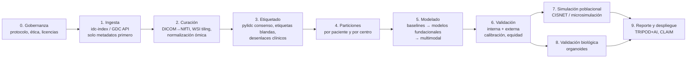

# Reporte de Investigación: Cáncer de Pulmón y Oportunidades para Modelado Computacional

| Campo | Detalle |
|---|---|
| **Versión** | v2 |
| **Fecha de consulta de fuentes** | 10 de octubre de 2026 |
| **Propósito** | Base teórica y técnica para diseñar un proyecto de I+D de modelos de IA para el diagnóstico, el tratamiento o la cura del cáncer de pulmón |
| **Alcance** | Las 10 fuentes indicadas, más metadatos públicos obtenidos de las API de GDC (NCI Genomic Data Commons) e IDC (NCI Imaging Data Commons, índice v25). **No se descargó ninguna imagen DICOM, lámina ni archivo genómico.** |
| **Convenciones** | `[n]` = fuente numerada de la lista original. `[C]` = conocimiento complementario del equipo, no extraído de las 10 fuentes. Debe verificarse antes de citarse en un manuscrito. |

> **Advertencia de uso.** Este documento orienta hipótesis y diseño de investigación. No es una guía clínica. Las indicaciones y aprobaciones de fármacos dependen del estadio, de los biomarcadores, del estado del paciente y del país.

### Trazabilidad de acceso a las fuentes

| # | Fuente | Estado de acceso | Observación |
|---|---|---|---|
| 1 | OMS: nota descriptiva | Texto completo | Publicada el 16-abr-2026 |
| 2 | NCI PDQ: tratamiento del CPCNP (paciente) | Texto completo, leído en dos tramos | Actualizada el 15-may-2025 |
| 3 | NCI: Lung Cancer Research | Texto completo | Última revisión: 01-nov-2024 |
| 4 | PMC11941068 | PMC bloqueó con verificación de navegador. Se obtuvo el **texto completo vía Europe PMC** | Bouchard & Daaboul, *Curr Oncol* 2025 |
| 5 | NCI PDQ, sección `#_164` | Misma página que la fuente 2: tratamiento por estadio | — |
| 6 | PMC10698950 | Igual que la 4: **texto completo vía Europe PMC** | Li et al., *Cell Commun Signal* 2023 |
| 7 | *Nature Reviews Clinical Oncology* | **Solo con suscripción.** Se leyeron el resumen, los *Key points* y los títulos de las figuras | Zhao et al., 2025 |
| 8 | CISNET: registro de modelos de pulmón | Página completa, más la tabla comparativa oficial en PDF (18-abr-2025) | — |
| 9 | TCIA: LIDC-IDRI | Página completa, más el índice de metadatos de IDC | Sin descarga de imágenes |
| 10 | IDC: TCGA-LUSC | El portal no muestra detalle por colección. Se usaron la API v3 de IDC, el índice `idc-index` (v25), la página de TCIA y la API de GDC | Sin descarga de imágenes |

---

## 1. Resumen Ejecutivo

**Carga de la enfermedad.** El cáncer de pulmón es la primera causa mundial tanto de casos como de muertes por cáncer. En 2022 hubo unos **2,5 millones de casos nuevos y 1,8 millones de muertes** [1]. El tabaquismo explica el **60–70 %** de los casos prevenibles. La OMS estima prevenibles más de 1,3 millones de casos en hombres y cerca de 500 000 en mujeres [1]. La mayoría de los diagnósticos se hacen en estadio avanzado. El tamizaje con TC de baja dosis (TCBD) en personas de alto riesgo reduce la mortalidad cuando se aplica con control de calidad y seguimiento [1, 3]. Aun así, la supervivencia global a 5 años sigue en **10–20 %** [6].

**Transformación terapéutica.** El CPCNP (~85 % de los casos) [1] se trata hoy según su perfil molecular. Existen terapias aprobadas para **nueve alteraciones genómicas accionables**: EGFR, ALK, ROS1, BRAF V600E, MET exón 14, RET, KRAS G12C, HER2/ERBB2 y NTRK [4]. A ellas se suma NRG1, con zenocutuzumab aprobado en 2025 [3]. Las terapias dirigidas ya llegan a la adyuvancia: osimertinib en EGFR (SG a 5 años 88 % frente a 78 %) y alectinib en ALK (SLE a 2 años 93,6 % frente a 63,7 %) [4]. Los inhibidores de punto de control (ICI) anti-PD-(L)1 y anti-CTLA4 cambiaron el tratamiento, pero la **resistencia primaria y la adquirida** limitan su beneficio [7]. En 2024 se aprobaron dos agentes de nueva generación: **ivonescimab** (biespecífico PD-1 × VEGF, China) y **tarlatamab** (DLL3 × CD3 para el CPCP, EE. UU.) [7].

**Vacíos que la IA puede atacar:**
1. Detectar antes y con menos falsos positivos.
2. Predecir la respuesta y la resistencia a ICI y TKI.
3. Encontrar dianas para el **carcinoma escamoso (LUSC)**, que casi no tiene alteraciones accionables.
4. Dar opciones a KRAS no-G12C, como G12D, G12V y G12A [4].
5. Pasar de la predicción a la decisión clínica validada prospectivamente.

**Modelos existentes.** CISNET reúne **10 modelos independientes de 8 instituciones** [8]. Son microsimulaciones y macromodelos poblacionales del tabaquismo, la historia natural, el tamizaje y la mortalidad. Respaldaron las guías de tamizaje del USPSTF. Sin embargo, **solo 3 modelan el tratamiento**, **2 incluyen biomarcadores** y ninguno usa datos de imagen a nivel de individuo [8]. Ese hueco es una oportunidad directa para acoplar IA y simulación.

**Datos.**
- **LIDC-IDRI**: 1 010 pacientes y 1 018 estudios de TC con anotaciones de 4 radiólogos. Unos 133 GB [9].
- **TCGA-LUSC**: 504 casos con multi-ómica completa en GDC (WXS, RNA-seq, metilación, número de copias, RPPA) y láminas histológicas digitales de los 504 en IDC. Pero **solo 37 pacientes tienen TC o PET** [10].

Por tanto, TCGA-LUSC sirve para **patología computacional + ómica**, no para radiogenómica a gran escala.

**Recomendación.** Arrancar con tres líneas de modelado que comparten infraestructura:
- **(A) Nódulos en TC**: LIDC-IDRI para desarrollo y NLST para validación con desenlace.
- **(B) Histopatología → genotipo/pronóstico**: TCGA-LUSC/LUAD con validación externa en CPTAC.
- **(C) Acoplamiento IA ↔ microsimulación CISNET**: evaluar el impacto poblacional del tamizaje guiado por riesgo de IA.

Las líneas de respuesta a inmunoterapia y descubrimiento de dianas requieren cohortes adicionales con datos de tratamiento y desenlace (sección 6).

---

## 2. Marco Clínico y Biológico

### 2.1 Epidemiología mundial y datos clave (OMS)

| Indicador | Valor | Fuente |
|---|---|---|
| Casos nuevos (2022) | **2,5 millones** | [1] |
| Muertes (2022) | **1,8 millones** | [1] |
| Posición mundial | Primera causa de **casos** de cáncer y de **muertes** por cáncer | [1] |
| Proporción mundial | ~**11,4 %** de los casos de cáncer y **18,0 %** de las muertes por cáncer | [6] |
| Casos prevenibles | >1,3 M en hombres; ~500 000 en mujeres | [1] |
| Fracción atribuible al tabaco | **60–70 %** de los casos prevenibles. Le siguen la contaminación del aire y la exposición ocupacional | [1] |
| Distribución histológica | CPCNP ≈ **85 %**; CPCP: menos frecuente y más agresivo | [1] |
| Supervivencia a 5 años | **10–20 %** | [6] |

**Factores de riesgo** [1, 2]:
- **Tabaco**: cigarrillos, puros y pipas. El riesgo aumenta con el inicio temprano, la frecuencia y los años de consumo.
- **Humo ajeno.**
- **Contaminación del aire**, tanto interior como ambiental.
- **Radón.**
- **Exposición ocupacional**: asbesto/amianto, sílice, gases de diésel, arsénico, cromo, berilio, níquel, hollín y alquitrán.
- **Radiación**: radioterapia previa de tórax o mama, TC y radiación de bomba atómica.
- **Otros**: neumopatías crónicas, antecedentes familiares o sensibilidad genética, infección por VIH, suplementos de betacaroteno en grandes fumadores y edad avanzada.

**Síntomas** [1]: tos persistente, dolor torácico, disnea, hemoptisis, fatiga, pérdida de peso sin causa e infecciones respiratorias recurrentes. Son poco específicos, lo que retrasa el diagnóstico.

**Tamizaje** [1, 3]:
- El ensayo NLST demostró la utilidad de la TCBD en grandes fumadores.
- En EE. UU. se recomienda en general entre **50 y 80 años** con **≥20 paquetes-año**.
- El USPSTF lo limita a fumadores actuales o a quienes dejaron de fumar en los últimos **15 años**. Otras sociedades no exigen ese límite.
- La OMS lo recomienda para personas de alto riesgo en entornos con recursos y control de calidad.
- `[C]` El NLST (53 454 participantes) mostró una reducción relativa de alrededor del 20 % en la mortalidad por cáncer de pulmón con TCBD frente a radiografía. El PDF original está en `Data_insumo/`.

**Respuesta de salud pública** [1]:
- Resolución **WHA70.12** (2017) sobre control integrado del cáncer.
- Resolución de **2025 (WHA78)** sobre salud pulmonar integrada.
- Plan de Acción Mundial para las ENT 2013–2030.
- Convenio Marco para el Control del Tabaco.
- Acceso equitativo a medicamentos esenciales y cobertura universal de salud.

### 2.2 Subtipos de cáncer de pulmón (CPCNP vs. CPCP)

| Rasgo | CPCNP (NSCLC) | CPCP (SCLC) |
|---|---|---|
| Frecuencia | ~85 % [1] | ~15 % `[C]` |
| Subtipos | **Adenocarcinoma** (LUAD), **escamoso o epidermoide** (LUSC) y **células grandes**. Variantes raras: adenoescamoso, sarcomatoide, tipo glándula salival, carcinoide y no clasificado [2] | Neuroendocrino de alto grado |
| Comportamiento | Variable según estadio y genotipo | Más agresivo y de diseminación temprana [1] |
| Alteraciones accionables | Frecuentes en **LUAD** y en no fumadores. **Raras en LUSC** [4] | Pocas. Diana de superficie **DLL3** (tarlatamab) [7] |
| Estadificación | TNM: oculto, 0, IA–IB, IIA–IIB, IIIA–IIIC, IVA–IVB [2] | Limitado o extenso (los modelos CISNET usan esta agrupación) [8] |
| Avances recientes | Terapias dirigidas en adyuvancia y quimioinmunoterapia perioperatoria [3, 4] | **Durvalumab** prolonga la supervivencia en estadio limitado (2024); **tarlatamab** aprobado en 2024 [3, 7] |

**Relevancia para IA.** La transformación histológica de adenocarcinoma EGFR+ a CPCP o a escamoso es un mecanismo de resistencia a osimertinib. Por eso se recomienda biopsiar en la progresión [4]. Es un caso de uso para modelos longitudinales de imagen o biopsia líquida que anticipen la transformación.

**Factores pronósticos** [2]: estadio (tamaño y diseminación), tipo histológico, mutaciones (EGFR, ALK), síntomas y estado general.

### 2.3 Vías moleculares, marcadores genéticos y terapias dirigidas

#### 2.3.1 Prueba molecular: principios [4]

- Se recomienda un **panel amplio por NGS**, que cubre las dianas actuales y las próximas. También pueden usarse IHC, FISH y PCR.
- La prueba puede hacerse en tejido o en **biopsia líquida (ctDNA)**.
- **PD-L1** se mide por IHC y solo en tejido. Es complementario al panel molecular.
- Debe ofrecerse en todo adenocarcinoma y en algunos escamosos o subtipos raros, sobre todo en personas sin antecedente de tabaquismo.
- Los autores piden que el estudio sea **reflejo** (automático) y abarque todos los estadios.

#### 2.3.2 Prevalencia de alteraciones accionables (CPCNP no escamoso avanzado) [4]

| Gen | Alteración | Prevalencia |
|---|---|---|
| **EGFR** | Comunes (del19, L858R) | 15 % (**50–60 % en población asiática**) |
| | Infrecuentes (G719X, L861Q, S768I) | 10 % |
| | Inserciones del exón 20 | 2 % |
| **KRAS** | G12C | **12 %** |
| **ALK** | Fusiones | 5 % |
| **MET** | Salto del exón 14 / amplificación | 3 % / 1–5 % |
| **ERBB2 (HER2)** | Mutación / amplificación / sobreexpresión IHC3+ | 2–5 % / 2–4 % / 2–4 % |
| **BRAF** | V600E (≈50 % de las mutaciones BRAF) | 2 % |
| **ROS1** | Fusiones | 1–2 % |
| **RET** | Fusiones | 1–2 % |
| **NTRK** | Fusiones | 0,23–3 % |

#### 2.3.3 Terapias dirigidas por diana y evidencia clave [4]

| Diana | Fármacos (generación o tipo) | Evidencia y métricas clave | Resistencia / vacío |
|---|---|---|---|
| **EGFR común** | 1.ª gen.: gefitinib, erlotinib · 2.ª gen.: afatinib, dacomitinib · 3.ª gen.: **osimertinib**, lazertinib · amivantamab (biespecífico EGFR × MET) | **FLAURA**: SLP 18,9 vs. 10,2 m (HR 0,46); SG 38,6 vs. 31,8 m (HR 0,80). **FLAURA2** (+ quimio): SLP 25,5 vs. 16,7 m (HR 0,62). **MARIPOSA** (amivantamab + lazertinib): SLP 23,7 vs. 16,6 m (HR 0,70). **MARIPOSA-2** tras osimertinib: SLP 6,3 vs. 4,2 m (HR 0,48). **PALOMA-3**: amivantamab subcutáneo no inferior | Resistencia a osimertinib por amplificación de MET o HER2, mutaciones de EGFR sobre la diana o fuera de ella, y **transformación a CPCP o escamoso**. Peor pronóstico con metástasis cerebrales, L858R, co-mutación TP53 o ctDNA+. **La inmunoterapia no aporta** (KEYNOTE-789) |
| **EGFR (adyuvancia)** | Osimertinib 3 años | **ADAURA**: SLE a 24 m 89 % vs. 52 % (HR 0,20); SG a 5 años 88 % vs. 78 % (HR 0,49) | Duración óptima desconocida |
| **EGFR (estadio III tras QRT)** | Osimertinib | **LAURA**: SLP 39,1 vs. 5,6 m (HR 0,16). Durvalumab no se recomienda en EGFR+ | SG inmadura |
| **EGFR infrecuente** | Afatinib; osimertinib caso a caso | UNICORN | Evidencia escasa |
| **EGFR exón 20** | Amivantamab ± quimio | **PAPILLON**: SLP 11,4 vs. 6,7 m (HR 0,40). En estudio: zipalertinib, sunvozertinib, furmonertinib | Poziotinib y mobocertinib se abandonaron |
| **ALK** | 1.ª gen.: crizotinib · 2.ª gen.: ceritinib, **alectinib**, brigatinib, ensartinib · 3.ª gen.: **lorlatinib**. En desarrollo: NVL-655 | **ALEX**: SLP 34,8 vs. 10,9 m (HR 0,43); progresión en SNC 12 % vs. 45 %. **ALTA-1L**: 24,0 vs. 11,1 m. **CROWN**: **SLP a 5 años 60 % vs. 8 %**, la más larga descrita para un agente dirigido único. **ALINA** (adyuvancia): SLE a 2 años 93,6 % vs. 63,7 % (HR 0,24) | Toxicidad metabólica y neurocognitiva de lorlatinib. No hay ensayos comparativos directos entre los TKI de 2.ª y 3.ª generación |
| **ROS1** | Crizotinib, **entrectinib**, **repotrectinib** (activo frente a G2032R), lorlatinib, zidesamtinib (NVL-520) | Crizotinib: TRO 72 %, SLP 19,3 m. Entrectinib: SLP 15,7 m, TRO intracraneal 80 %. Repotrectinib (TRIDENT-1): SLP 35,7 m | El fase 3 entrectinib vs. crizotinib tendrá resultados en 2027 |
| **BRAF V600E** | Dabrafenib + trametinib; encorafenib + binimetinib | TRO 64 %; SG a 5 años 22 %. PHAROS: TRO 75 % | Acceso variable según país |
| **MET exón 14** | Capmatinib, tepotinib (crizotinib) | GEOMETRY: TRO 68,3 %. VISION: TRO 57,3 %, SLP 15,9 m | **Amplificación de MET**: sin aprobación. En estudio: savolitinib o tepotinib + osimertinib (SAVANNAH, SAFFRON, INSIGHT 2) |
| **RET** | Pralsetinib, **selpercatinib** | **LIBRETTO-431**: SLP 24,8 vs. 11,2 m frente a quimio ± pembrolizumab | Adyuvancia en estudio (LIBRETTO-432) |
| **KRAS G12C** | Sotorasib, adagrasib, divarasib (en desarrollo) | **CodeBreaK200**: SLP 5,6 vs. 4,5 m, **SG sin diferencia (HR 1,01)**. **KRYSTAL-12**: SLP 5,49 vs. 3,84 m (HR 0,58) | Primera línea: sigue siendo inmunoterapia ± quimio. **G12D, G12V y G12A no son accionables** |
| **HER2/ERBB2** | **Trastuzumab deruxtecan** (ADC), zongertinib | DESTINY-Lung01: TRO 55 %. DESTINY-Lung02: dosis de 5,4 mg/kg preferible por menor riesgo de neumonitis | Primera línea: inmuno + quimio. DESTINY-Lung04 en curso |
| **NTRK** | Larotrectinib, entrectinib. 2.ª gen.: repotrectinib, selitrectinib, taletrectinib | Larotrectinib: TRO 66 %, SLP 22 m, SG 39 m (n = 32) | Cohortes muy pequeñas |
| **NRG1** | Zenocutuzumab (aprobado en 2025) | — | Alteración rara [3] |
| **Post-TKI (ADC)** | Datopotamab deruxtecan, patritumab deruxtecan | Dato-DXd: designación de la FDA para EGFR+ (TROPION-Lung01/05) | — |

**Fenotipos asociados** [4]:
- **EGFR, ALK, ROS1, RET, NTRK y HER2**: más frecuentes en no fumadores, adenocarcinoma, mujeres o población asiática.
- **KRAS G12C**: más frecuente en fumadores.
- **BRAF y METex14**: sin fenotipo claro. METex14 aparece en el 20–30 % de los sarcomatoides.
- ALK y ROS1 se asocian a tromboembolia venosa (OR 2,10 y 3,15).

**Implicación para IA.** Estos fenotipos clínicos (tabaco, sexo, etnia, histología) son **predictores débiles pero reales**. Un modelo de "genotipo a partir de imagen o histología" debe superar claramente a un modelo basado solo en variables clínicas para justificar su uso.

---

## 3. Estado del Arte en Tratamientos e Investigación Reciente

### 3.1 Tratamientos estándar (NCI PDQ, actualizado el 15-may-2025)

**Modalidades** [2]:
- **Cirugía**: en cuña, segmentectomía, lobectomía, neumonectomía y en manguito.
- **Radioterapia**: externa, incluidas la estereotáctica corporal (SBRT) y la radiocirugía para metástasis cerebrales, e interna (braquiterapia).
- **Quimioterapia**: carboplatino, cisplatino, docetaxel, doxorrubicina, etopósido, gemcitabina, paclitaxel, pemetrexed y vinorelbina.
- **Terapia dirigida**: 28 fármacos listados, de adagrasib a trametinib.
- **Inmunoterapia**: atezolizumab, cemiplimab-rwlc, durvalumab, ipilimumab, nivolumab, pembrolizumab y tremelimumab.
- **Técnicas locales endoscópicas**: láser, terapia fotodinámica, criocirugía y electrocauterización.

**Tratamiento por estadio** [2, 5]:

| Estadio | Opciones estándar |
|---|---|
| **Oculto** | Según el estadio. Suele detectarse temprano y a veces se cura con cirugía |
| **0 (in situ)** | Resección en cuña o segmentaria. Terapia fotodinámica, electrocauterización, criocirugía o láser si es endobronquial |
| **IA–IB** | Cirugía (cuña, segmentaria, manguito o lobectomía). Cirugía seguida de terapia dirigida, o de quimio + inmunoterapia. SBRT si no es operable |
| **IIA–IIB** | Cirugía seguida de quimio, dirigida, inmuno, radioterapia o quimio + inmuno. Quimio y luego cirugía. **Quimio + inmuno y luego cirugía (± inmuno posterior)**. Radioterapia si no es operable |
| **IIIA resecable** | Neoadyuvancia con quimio o quimio-radioterapia, luego cirugía. Quimio + inmuno perioperatoria. Cirugía con adyuvancia multimodal |
| **IIIA no resecable** | Quimio-radioterapia ± inmunoterapia de consolidación (p. ej., durvalumab, PACIFIC [4]). Radioterapia sola. Paliación |
| **Pancoast / pared torácica** | Cirugía, quimio-radioterapia más cirugía, o radioterapia sola |
| **IIIB–IIIC** | Quimio-radioterapia secuencial o concurrente. **Nivolumab o pembrolizumab + quimio, luego cirugía e inmuno**. Inmuno o dirigida antes o después de la quimio-radioterapia. Paliación |
| **IV (nuevo o recidiva)** | Quimio ± dirigida. Quimio combinada con mantenimiento. Dirigida. Inmunoterapia, uno o más fármacos |
| **IV progresivo** | Quimio, dirigida ± quimio, o inmunoterapia |

**Hitos regulatorios recientes** [3]:
- Atezolizumab y pembrolizumab en adyuvancia.
- Nivolumab + quimio neoadyuvante (2022).
- Pembrolizumab perioperatorio.
- Osimertinib adyuvante (2021).
- Alectinib adyuvante (2024).
- Repotrectinib para ROS1 (finales de 2023).
- Zenocutuzumab para NRG1 (2025).
- Durvalumab en CPCP limitado (2024).
- Lorlatinib retrasa el crecimiento de ALK+ y puede prevenir metástasis cerebrales (2024).
- En cirugía, la **resección sublobar** es tan eficaz como la lobectomía en ciertos CPCNP tempranos.

### 3.2 Programas y ensayos del NCI [3]

| Programa | Diseño | Relevancia para IA |
|---|---|---|
| **ALCHEMIST** (2014–) | Terapia dirigida adyuvante según genotipo en CPCNP temprano | Cohorte con genotipo y desenlace tras cirugía |
| **Lung-MAP** | Plataforma *umbrella*: asigna tratamiento según genómica en CPCNP avanzado | Datos genómicos y de respuesta |
| **Pragmatica-Lung** | Ramucirumab + pembrolizumab vs. quimio tras progresión a inmuno + quimio | Ensayo pragmático con datos del mundo real |
| **SCLC Consortium** | Coordinación de investigación preclínica en CPCP | Datos compartidos |
| **Lung SPOREs** (8) | Programas traslacionales | Biobancos |
| **IA e imagen** | ML que identifica cáncer en TC. Un estudio clasificó dos tipos histológicos con **97 % de exactitud** y detectó mutaciones | Prueba de concepto para patología computacional |
| **Biomarcadores tempranos** | Pruebas en sangre (células tumorales, marcadores moleculares) y en esputo | Biopsia líquida |

### 3.3 Terapias emergentes: inmunoterapia de nueva generación (*Nature Rev Clin Oncol*, 2025) [7]

> Fuente con suscripción: se analizaron el resumen, los *Key points* y la estructura de las figuras. Las cifras de los ensayos citados en el cuerpo del artículo no pudieron verificarse.

**Problema central.** La mayoría de los pacientes no responde a los ICI anti-PD-(L)1 o anti-CTLA4. Y casi todos los que responden acaban progresando por **resistencia adquirida**. El artículo propone **tres "inmunotipos"** de tumor con mecanismos de resistencia distintos (Fig. 2).

| Modalidad emergente | Ejemplos | Estado | Obstáculos |
|---|---|---|---|
| **ICI de nueva diana o diseño** | Moduladores de nuevos puntos de control (Fig. 3) | Ensayos clínicos | Equilibrio entre eficacia y toxicidad |
| **ICI biespecíficos** | **Ivonescimab** (PD-1 × VEGF): aprobado en China (2024) para CPCNP EGFR mutado | Aprobado | Generalizar el beneficio a otras poblaciones |
| **Engranadores de células inmunes** | **Tarlatamab** (DLL3 × CD3, BiTE): aprobado en EE. UU. (2024) para CPCP | Aprobado | Toxicidad: síndrome de liberación de citocinas, neurotoxicidad |
| **Terapia celular adoptiva** | CAR-T, TCR-T, TIL | Actividad en fases tempranas | **Heterogeneidad tumoral**, toxicidad sobre la diana fuera del tumor, **fabricación** |
| **Vacunas terapéuticas** | Antígenos compartidos, **neoantígenos personalizados**, antígenos anónimos | Buena tolerancia e inmunogenicidad | Poca traducción en respuesta o supervivencia |
| **Estrategias futuras** | Combinaciones entre modalidades; agentes **activados condicionalmente** por el microambiente tumoral | Conceptual o temprano | — |

### 3.4 Modelos preclínicos: organoides tumorales (Li et al., 2023) [6]

- **Comparación de modelos.** Las líneas 2D son baratas, pero sufren deriva genética y carecen de microambiente tumoral. Los PDX conservan la heterogeneidad, pero son caros, lentos y se hacen en ratones inmunodeficientes, así que **no sirven para evaluar inmunoterapia**. Los **organoides derivados del paciente (PDO)** son baratos, escalables, editables con CRISPR y aptos para biobancos.
- **Hitos.**
  - 2017: 56 PDO de 769 pacientes para cribado de fármacos de alto rendimiento.
  - 2019: los organoides de Sachs conservan la histología y las mutaciones.
  - Biobanco de **80 organoides de 5 subtipos histológicos** (Kim et al.).
  - Organoides de LUAD, LUSC (CRISPR, SOX2) y CPCP (WNT3A/R-spondin).
- **Valor predictivo.** Estudio del mundo real (Wang): **concordancia >80 %** entre la sensibilidad del organoide y la respuesta clínica en cáncer avanzado, variable según el fármaco. Respuestas de cientos de organoides **en menos de 1 semana** (Hu et al.). Microfluídica con 100 % de exactitud y especificidad en un estudio. Fase II: pyrotinib mejor que afatinib en HER2, predicho por el organoide.
- **Contexto regulatorio.** La **FDA Modernization Act 2.0** (dic-2022) permite sustituir la experimentación animal por modelos alternativos.
- **Limitaciones.**
  - Sin vasculatura, sistema inmune ni matriz extracelular reales.
  - **Sobrecrecimiento de células epiteliales normales**: tasa de establecimiento del 41 %, pero solo **17 % de organoides puramente tumorales** (Dijkstra).
  - Falta estandarización.
  - Evidencia aún **observacional**.
- **Frentes tecnológicos**: chips microfluídicos, *scaffolds* de hidrogel, bioimpresión 3D, scRNA-seq, CRISPR y cocultivo con células T o macrófagos.

### 3.5 Principales vacíos científicos hacia terapias curativas o predictivas

| # | Vacío | Evidencia | Oportunidad computacional |
|---|---|---|---|
| G1 | **Diagnóstico tardío** | La mayoría de los casos se detectan avanzados; el tamizaje es infrautilizado o selectivo [1, 3] | Riesgo individual desde TC y variables clínicas; ampliar la elegibilidad más allá de los paquetes-año |
| G2 | **Falsos positivos y sobrediagnóstico** en TCBD | Los modelos CISNET modelan nódulos benignos en solo 3 de 10 casos [8] | Clasificación de malignidad de nódulos y estimación de incertidumbre |
| G3 | **Resistencia a TKI** | Osimertinib: MET o HER2, mutaciones en la diana o fuera, transformación histológica [4] | Modelos longitudinales (ctDNA + imagen) que anticipen el mecanismo de resistencia |
| G4 | **Resistencia a ICI** | La mayoría no responde y casi todos progresan; tres inmunotipos [7] | Predicción de respuesta multimodal: PD-L1, TMB, patología, radiómica |
| G5 | **LUSC sin dianas** | Las alteraciones accionables se concentran en LUAD [4] | Descubrimiento de dianas en multi-ómica de TCGA-LUSC |
| G6 | **KRAS no-G12C**; KRAS G12C sin beneficio en SG | G12D, G12V y G12A no son accionables; CodeBreaK200 con HR de SG 1,01 [4] | Priorización de combinaciones y biomarcadores de respuesta |
| G7 | **Metástasis en SNC** | Determinan la elección de TKI (alectinib, lorlatinib, osimertinib) [4] | Predicción de riesgo de metástasis cerebral |
| G8 | **Duración y desescalada** | ¿3 años de osimertinib adyuvante? ¿Omitir la quimio en ALK+ adyuvante? [4] | Ensayos *in silico* y emulación de ensayos objetivo (*target trial emulation*) con datos del mundo real |
| G9 | **Toxicidad** | Neumonitis por T-DXd, tromboembolia con amivantamab, toxicidad tras ICI + KRASi [4]. Equilibrio entre eficacia y seguridad [7] | Predicción de eventos adversos |
| G10 | **Traducción preclínica** | Organoides sin inmunidad ni vasculatura; evidencia observacional [6] | Modelos híbridos organoide + ML para predecir la respuesta del paciente |
| G11 | **Equidad y acceso** | Acceso a fármacos variable según país [4]; estigma [3] | Validación en poblaciones diversas, incluida Latinoamérica |

---

## 4. Modelos Existentes y Repositorios Computacionales

### 4.1 CISNET: arquitectura común

CISNET (*Cancer Intervention and Surveillance Modeling Network*, NCI) mantiene **10 modelos independientes de 8 instituciones** [8]. El registro lista además SimSmoke y el modelo histórico LMO de FHCC. Todos los modelos:
- **Comparten entradas**: el *Smoking History Generator* (SHG), mortalidad por otras causas y datos de NHIS, CPS-I/II, HMD, NHS/HPFS, SEER, PLCO y NLST.
- **Producen**: incidencia y mortalidad por cáncer de pulmón y mortalidad general, a nivel individual o poblacional, bajo escenarios de control del tabaco o de tamizaje.
- **Se usaron** con el **USPSTF** para revisar sus recomendaciones de tamizaje.

### 4.2 Comparación de modelos (tabla oficial, 18-abr-2025) [8]

| Modelo (institución) | Tipo | Propósito original | Dosis-respuesta / carcinogénesis | Histologías | Progresión | Sensibilidad del tamizaje | Crecimiento tumoral | Nódulos benignos | Biomarcadores | Tratamiento |
|---|---|---|---|---|---|---|---|---|---|---|
| **BCCRI-Smoking** (BC Cancer) | Microsimulación | Escenario base de tabaquismo | TSCE | N/A | N/A | N/A | N/A | N/A | N/A | No |
| **BCCRI-LunCan** (BC Cancer; antes UM-LCSc) | Microsimulación | Evaluar TCBD | TSCE, Bach, PLCOm2012, LCRAT | AD+BAC, SQ, SCLC, otros | Modelo retrospectivo desde histología y estadio al diagnóstico | Por estadio e histología | — | No | Propuesto | Propuesto |
| **MISCAN-Lung** (Erasmus MC) | Microsimulación | Prevención primaria y secundaria | TSCE | AD+BAC+células grandes, SQ, SCLC, O-NSCLC | Markov por histología | Por estadio e histología | — | No | Propuesto | Propuesto |
| **GSBCM / Smoking-Lung Macro** (Georgetown) | Macromodelo | Escenario base de tabaquismo | TSCE, Knoke, Flanders, Doll | N/A | N/A | N/A | N/A | N/A | Propuesto | No |
| **MULU** (Mount Sinai) | Microsimulación | Evaluar TCBD | Funciones logísticas calibradas (NLST, PLCO, datos de Mount Sinai y VA) | AD, AIS, células grandes, SQ, SCLC, otros | Tamaño tumoral y carga metastásica | Tamaño (mm) e histología | **Sigmoide** | **Sí** | **Incluido** | **Sí** |
| **ENGAGE** (MD Anderson) | Microsimulación + **POMDP** (proceso de decisión de Markov parcialmente observable) | Prevención primaria y secundaria | Bach, PLCOm2012, PLCO_ENGAGE | AD, SQ, SCLC, otros | Markov por histología, **tipo de nódulo y sexo** | Estadio, histología, sexo y tipo de nódulo | **Gompertz** | **Sí** (Lung-RADS optimizado) | Propuesto | Propuesto |
| **LCPM** (MGH-ITA) | Microsimulación | TCBD y cesación tabáquica | Probabilística por histología | AD, AIS, células grandes, SQ, SCLC, otros | Volumen tumoral y carga metastásica (metástasis explícitas) | Tamaño (mm) y **localización central o periférica** | **Gompertz** | **Sí** (Fleischner y Lung-RADS) | **Incluido** | **Sí** |
| **OncoSim-Lung** (CPAC-StatCan, Canadá) | Microsimulación | Evaluar TCBD | PLCOall2014 + **riesgo por radón** | SCLC, NSCLC | — | Por ronda de tamizaje | — | No | N/A | **Sí** |
| **LCOS** (Stanford) | Microsimulación | Evaluar TCBD (ensayos o cohortes) | TSCE | AD, células grandes, SQ, SCLC, BAC | Volumen tumoral y carga metastásica | Tamaño (mm) e histología | **Exponencial** | No | Propuesto | Propuesto |
| **YLCM** (Yale) | Macromodelo | Escenario base de tabaquismo (tasas poblacionales) | TSCE, Knoke | N/A | N/A | N/A | N/A | N/A | N/A | Propuesto |

**Otros detalles de la tabla:**
- **Efecto del tamizaje**: según el modelo, se representa como modelo de cura, detección en estadio más temprano o desplazamiento de estadio (OncoSim-Lung: desplazamiento de estadio en CPCNP).
- **Calibración de la incidencia**: SEER, NLST y PLCO (Canadian Cancer Registry en OncoSim).
- **Supervivencia**: SEER 17/18 en distintos periodos, de 1988 a 2021.
- **Seguimiento del nódulo positivo**: implícito (NLST o Lung-RADS) o explícito (Lung-RADS, Fleischner).
- **Metástasis**: explícitas en MULU, LCPM, OncoSim y LCOS; implícitas en el resto.

> **Nota de consistencia.** El orden de columnas extraído del PDF sugiere que la primera columna corresponde a BCCRI-Smoking y la segunda a BCCRI-LunCan, por la coherencia de la dosis-respuesta y las histologías con la página del registro. Conviene contrastarlo con los perfiles individuales en `cisnet.cancer.gov/lung/#profiles-registry`.

### 4.3 Componentes matemáticos clave

- **TSCE (Two-Stage Clonal Expansion)**: modelo estocástico de carcinogénesis en el que el tabaco modula la iniciación, la promoción (expansión clonal de células intermedias) y la malignización. Lo usan 6 de los 10 modelos.
- **Modelos de riesgo empíricos**: PLCOm2012, Bach, LCRAT y PLCOall2014. Son regresiones logísticas o de Cox con edad, tabaquismo, EPOC, antecedentes y otras variables `[C]`.
- **Crecimiento tumoral**: exponencial (LCOS), Gompertz (ENGAGE, LCPM) o sigmoide (MULU). Estas funciones son las **interfaces naturales con la volumetría de nódulos derivada de IA**.
- **Decisión secuencial**: ENGAGE acopla la microsimulación con un **POMDP** para optimizar los intervalos de tamizaje. Es el antecedente más cercano a un "tamizaje adaptativo guiado por IA".

### 4.4 Utilidad y limitaciones para el proyecto

| Fortaleza | Limitación (oportunidad) |
|---|---|
| Validados en ensayos (NLST, PLCO) y usados en política pública (USPSTF) | **Poblacionales**: no usan imagen ni ómica a nivel de paciente |
| Comparación multimodelo que da robustez | Solo 3 de 10 modelan **tratamiento**; 2 de 10 incluyen **biomarcadores**; 3 de 10 modelan **nódulos benignos** |
| Historia natural explícita: crecimiento y estadio | Calibrados en EE. UU. y Canadá: hay que **recalibrarlos para otras poblaciones**, como Latinoamérica, con otra prevalencia de tabaco, humo de leña o radón |
| Marco listo para análisis de costo-efectividad | No representan inmunoterapia, terapia dirigida ni resistencia de forma mecanicista |

**Conclusión.** Los modelos CISNET son el **sustrato ideal para evaluar el impacto poblacional** de un modelo de IA, por ejemplo: "¿cuántas muertes evita un tamizaje con elegibilidad e intervalos definidos por riesgo de IA?". No sirven para la decisión terapéutica individual.

---

## 5. Inventario de Datasets de Imágenes y Datos Ómicos (TCIA / IDC)

> Cifras obtenidas de las páginas de TCIA y del índice de metadatos de IDC (`idc-index`, versión de datos **v25**), consultado el 10-oct-2026. **No se descargaron imágenes.**

### 5.1 LIDC-IDRI (Lung Image Database Consortium & Image Database Resource Initiative) [9]

| Atributo | Valor |
|---|---|
| **Pacientes** | **1 010**. Los 1 018 "casos" de la descripción corresponden a 1 018 estudios de TC; **8 pacientes tienen dos TC** |
| **Estudios / series / imágenes (TCIA)** | 1 308 / 1 308 / **244 527** |
| **Modalidades** | **TC torácica** (1 010 pacientes, 1 018 series, 243 958 cortes, 125,4 GB). **DX** (237 pacientes, 3,9 GB). **CR** (53 pacientes, 0,7 GB) |
| **Tamaño total** | **~133 GB** (TCIA 133,15 GB; IDC 133,35 GB) |
| **Origen** | 7 centros académicos y 8 empresas de imagen. TC diagnósticas y de tamizaje |
| **Proceso de anotación** | **4 radiólogos torácicos** en **dos fases**. En la lectura *ciega*, cada uno marcó por separado. En la lectura *no ciega*, cada uno revisó sus marcas junto a las de los otros tres, de forma anónima. **No se forzó consenso** |
| **Categorías de lesión** | **Nódulo ≥3 mm**: contorno completo y características. **Nódulo <3 mm**: solo centroide. **No-nódulo ≥3 mm**: solo centroide |
| **Características del nódulo** | Sutileza, estructura interna, calcificación, esfericidad, margen, **lobulación**, **espiculación**, textura y **malignidad**, en escalas de 1 a 5 `[C]` para la lista completa |
| **Formato de anotaciones** | XML (ZIP de 8,62 MB, esquema `voi array.xsd`). En IDC también como **DICOM SEG** (875 pacientes, 6 949 segmentaciones) y **DICOM SR** (875 pacientes) dentro de `dicom_lidc_idri_nodules` |
| **Diagnóstico confirmado** | **Solo un subconjunto limitado** (XLS) con nivel de paciente y de nódulo: desconocido, benigno, primario de pulmón o metástasis. Se confirmó por estabilidad radiológica, biopsia, resección o progresión. **El proyecto terminó y no habrá más datos** |
| **Licencia / DOI** | **CC BY 3.0** · DOI 10.7937/K9/TCIA.2015.LO9QL9SX · Armato et al., *Med Phys* 38:915–931 (2011) |
| **Herramientas** | **pylidc** (ORM en Python: agrupa anotaciones en nódulos, genera máscaras de consenso y se recomienda antes de escribir un analizador XML propio), MAX (Perl) y LIDC 2 Image Toolbox (MATLAB) |
| **Problemas conocidos** | ~100 casos con escalas inconsistentes de espiculación y lobulación. 044.xml y 191.xml tienen nódulos sin características. Valor inválido de `internalStructure` en LIDC-IDRI-0510. **El orden de los lectores en el XML no es consistente** entre exploraciones, así que no se puede modelar un lector concreto |
| **Versión vigente** | v4 (21-sep-2020). Los manifiestos anteriores al 24-feb-2020 pueden estar incompletos |

**Implicaciones metodológicas:**
1. La "malignidad" es una **puntuación subjetiva del radiólogo**, no una confirmación patológica. Un modelo entrenado con ella aprende el criterio del radiólogo, no la biología. Para un desenlace real hay que validar con NLST o con el subconjunto con diagnóstico.
2. Las 4 lecturas sin consenso permiten **etiquetas probabilísticas o blandas** y modelar la **incertidumbre aleatoria** entre lectores.
3. `[C]` Variantes derivadas conocidas: LUNA16 (888 TC, nódulos aceptados por ≥3 de 4 radiólogos) y LNDb. Hay que **dividir por paciente** para evitar fuga de datos.

### 5.2 TCGA-LUSC (The Cancer Genome Atlas: Lung Squamous Cell Carcinoma) [10]

**Visión integrada de los tres portales:**

| Componente | Portal | Pacientes | Detalle |
|---|---|---|---|
| **Clínico y biospecímenes** | GDC | **504** | Formularios clínicos TCGA; instantánea en TCIA (16 KB, actualizada en v4) |
| **Genómica** | GDC | 504 | **WXS** 502 · **WGS** 337 · **Genotipado (SNP array)** 504 · Variantes de nucleótido simple 504 · **Número de copias** 504 · Variación estructural 501 |
| **Transcriptómica** | GDC | 501 | **RNA-seq** 501 · **miRNA-seq** 488 · Microarray de expresión 134 |
| **Epigenómica** | GDC | 503 | **Metilación** (array) 503 · **ATAC-seq** 16 |
| **Proteómica** | GDC | 328 | **RPPA** 328 |
| **Histopatología** | GDC / IDC | 495 (tejido) / 478 (diagnóstico) | En IDC: **504 pacientes, 1 612 láminas digitales (SM, DICOM-WSI), 610 GB** |
| **Radiología** | TCIA / IDC | **37** | **TC** 37 pacientes (71 estudios, 235 series, 14,2 GB) · **PET** 23 pacientes · **Medicina nuclear** 2 pacientes · Total en TCIA 15,02 GB, 36 518 imágenes |
| **Resultados de análisis (IDC)** | IDC | — | Mapas de **TIL** (`tcga_sbu_til_maps`, 478 pacientes) · Segmentación de **núcleos pan-cáncer** (396) · Segmentaciones radiológicas **BAMF/AIMI** (15) · Además en TCIA: Crowds-Cure-2018, SAROS, TIL-WSI-TCGA |
| **Volumen total** | GDC ~234 TB (mayoritariamente lecturas crudas) · IDC 1 076 GB | | |
| **Licencia / DOI** | Imagen: **CC BY 3.0** (anotaciones CC BY 4.0) · DOI 10.7937/K9/TCIA.2016.TYGKKFMQ · Láminas SM en IDC: doi 10.5281/zenodo.12690008. `[C]` Las lecturas crudas (BAM) y los genotipos germinales son de **acceso controlado** (dbGaP); los datos procesados (MAF enmascarado, expresión, número de copias) son abiertos |

**Coordinación clínica–genómica–imagen.** El identificador común es el **barcode de paciente TCGA** (p. ej., `TCGA-XX-XXXX`). Corresponde al `PatientID` en IDC y TCIA y al `submitter_id` del caso en GDC. Se verificó que **los 37 pacientes con TC también tienen láminas de histopatología**. Por eso existe una pequeña cohorte radiología + patología + multi-ómica + clínica, útil como **piloto o para validación cualitativa**, pero insuficiente para entrenar un modelo radiogenómico.

**Implicaciones:**
1. **Fortaleza principal**: histopatología + multi-ómica + supervivencia en ~500 pacientes. Es ideal para **patología computacional** (subtipo, mutación, firma inmune, pronóstico) y para **descubrimiento de dianas**.
2. **Limitación**: los pacientes son quirúrgicos y de estadios tempranos o intermedios. Hay **poca información de tratamiento sistémico y ninguna de inmunoterapia**. No sirve para predecir la respuesta a ICI.
3. **Sesgo de sitio**: el centro de origen (TSS en el barcode) se puede filtrar en las láminas. Hay que **estratificar las particiones por centro**.

### 5.3 Datasets complementarios (verificados en el índice IDC v25)

| Colección | Pacientes | Modalidades | Utilidad |
|---|---|---|---|
| **NLST** | **26 410** | TC (+ láminas SM, SR, SEG) | Tamizaje con desenlace (cáncer confirmado y mortalidad). **Validación externa** del modelo de nódulos y riesgo. `[C]` Los datos clínicos completos requieren solicitud a CDAS |
| **TCGA-LUAD** | 560 | TC, PET, NM, SM, SEG, ANN | Contraparte de adenocarcinoma, con alteraciones accionables (EGFR, KRAS, etc.) |
| **CPTAC-LSCC / CPTAC-LUAD** | 212 / 244 | TC, PET, SM (y RM en LUAD) | **Proteogenómica**: validación externa de los modelos de patología y ómica de TCGA |
| **NSCLC-Radiomics** | 422 | TC, RTSTRUCT, SEG | Radiómica pronóstica (supervivencia) |
| **NSCLC-Radiogenomics** | 211 | TC, PET, SEG | Radiogenómica: imagen + expresión + mutación |
| **Lung-PET-CT-Dx** | 355 | TC, PET | Clasificación histológica desde imagen |
| **Anti-PD-1 Lung** | 46 | PET, TC, SEG | **Respuesta a inmunoterapia** (pequeña; útil como validación exploratoria) |
| **NSCLC-Radiomics-Genomics** | 89 | TC | Radiogenómica |
| **SPIE-AAPM Lung CT Challenge** | 70 | TC, SEG | Benchmark de malignidad de nódulos |
| **4D-Lung** | 20 | TC 4D | Planificación de radioterapia |

---

## 6. Oportunidades para la Creación de Nuevos Modelos / Propuesta de Investigación

### 6.1 Cartera de modelos propuestos

| ID | Modelo | Vacío que ataca | Datos de desarrollo | Validación externa | Viabilidad con datos públicos | Impacto |
|---|---|---|---|---|---|---|
| **A** | **Detección, segmentación y malignidad de nódulos con incertidumbre** | G1, G2 | LIDC-IDRI (1 010) | NLST (subconjunto con cáncer confirmado), SPIE-AAPM, LNDb `[C]` | **Alta** | Alto |
| **B** | **Riesgo de cáncer a 1–6 años desde TCBD** (estilo *Sybil* `[C]`) + integración con CISNET | G1, G2 | NLST | Cohortes locales | Alta (NLST abierto en IDC) | Muy alto |
| **C** | **Histopatología → subtipo, genotipo, microambiente inmune y pronóstico** | G3, G4, G5 | TCGA-LUSC + TCGA-LUAD (~1 060 pacientes, SM) | CPTAC-LSCC/LUAD (456) | **Alta** | Alto |
| **D** | **Integración multimodal para supervivencia** (patología + ómica + clínica) | G4, G8 | TCGA-LUSC/LUAD | CPTAC | Media-alta | Alto |
| **E** | **Descubrimiento y priorización de dianas en LUSC** | G5, G6 | Multi-ómica TCGA-LUSC + CPTAC-LSCC; `[C]` DepMap/CCLE | Validación en **organoides** [6] | Media | **Muy alto** (curativo) |
| **F** | **Predicción de respuesta a ICI** | G4 | `[C]` Cohortes con ICI: Anti-PD-1 Lung (46), cohortes de MSK y Stanford, datos de ensayos | Prospectiva | **Baja con datos públicos**: requiere alianzas | Muy alto |
| **G** | **Gemelo digital híbrido mecanicista + ML** de crecimiento y resistencia a TKI | G3, G7, G8 | Volumetría longitudinal (NLST, LIDC con 2 tiempos) + parámetros CISNET (Gompertz, exponencial) + literatura [4] | Cohortes con ctDNA | Media | Alto |
| **H** | **Predicción de respuesta en organoides → paciente** | G10 | Datos propios o de colaboradores (PDO + ómica + respuesta) | Concordancia clínica (>80 % de referencia [6]) | Baja (requiere laboratorio) | Alto |

### 6.2 Fichas técnicas de los modelos prioritarios

#### A. Nódulos en TC con incertidumbre entre lectores
- **Tareas**:
  - (i) Detección 3D. `[C]` Línea de base: nnDetection o RetinaNet 3D.
  - (ii) Segmentación. `[C]` Línea de base: nnU-Net.
  - (iii) Malignidad, combinando la puntuación de los radiólogos con el diagnóstico confirmado.
  - (iv) Atributos: espiculación, lobulación, textura y calcificación.
- **Novedad**: aprender de las **4 lecturas no consensuadas** mediante etiquetas blandas o modelos probabilísticos de segmentación (`[C]` p. ej., Probabilistic U-Net), y medir la **incertidumbre calibrada**. Esto ataca directamente los falsos positivos de la TCBD.
- **Etiquetas**: con pylidc, consenso al 50 %. Malignidad: media o mediana de los lectores, excluyendo la puntuación 3 (indeterminada) en la versión binaria. Alternativa: regresión ordinal.
- **Métricas**: FROC/CPM (detección), Dice y HD95 (segmentación), AUC, calibración (ECE, Brier) y beneficio neto (análisis de curva de decisión).
- **Puente con la clínica**: traducir la salida a categorías **Lung-RADS** y medir el cambio frente a la lectura estándar.

#### B. Riesgo longitudinal desde TCBD + evaluación poblacional con CISNET
- **Entrada**: una o varias TCBD de NLST. **Salida**: riesgo de cáncer de pulmón a 1–6 años.
- **Aporte original**: usar el riesgo de IA como **variable de elegibilidad o de intervalo** dentro de un modelo CISNET. Los candidatos son **ENGAGE** (POMDP) o **MISCAN-Lung**, mediante colaboración, porque los códigos no son necesariamente abiertos `[C]`. Se compararían estrategias: anual uniforme, Lung-RADS y adaptativa por IA. Desenlaces: muertes evitadas, sobrediagnóstico, falsos positivos y años de vida ganados.
- **Alternativa propia**: microsimulación ligera con crecimiento de **Gompertz** (como LCPM y ENGAGE), calibrada con NLST y SEER y parametrizada con la volumetría del modelo A.

#### C. Patología computacional (TCGA-LUSC/LUAD → CPTAC)
- **Tareas**:
  - LUAD vs. LUSC. El NCI cita un 97 % de exactitud [3].
  - Predicción de mutaciones: TP53, KRAS, EGFR, STK11, KEAP1; en LUSC además SOX2, PIK3CA y CDKN2A `[C]`.
  - Firma inmune: densidad de **TIL** con los mapas `tcga_sbu_til_maps`; inmunotipos del artículo de Nature [7].
  - Riesgo de supervivencia.
- **Método `[C]`**: aprendizaje de múltiples instancias débilmente supervisado (ABMIL, CLAM o TransMIL) sobre embeddings de **modelos fundacionales de patología** (UNI, CONCH, Virchow, Prov-GigaPath).
- **Control de sesgos**: particiones por **centro (TSS)**, normalización de color y prueba de detección del sitio.

#### D/E. Integración multi-ómica y descubrimiento de dianas en LUSC
- **D**: fusión tardía o por atención entre embeddings de lámina, expresión, metilación, número de copias y variables clínicas. Desenlace: supervivencia global o libre de progresión, con Cox profundo o supervivencia discreta. Interpretabilidad: atención co-modal y SHAP.
- **E**: es la línea con más potencial "curativo". LUSC casi no tiene alteraciones accionables [4]. La propuesta:
  1. Subtipificación integrativa (MOFA+ o SNF `[C]`).
  2. **Grafos de conocimiento** (genes, vías, fármacos) con GNN para priorizar dianas y reposicionar fármacos.
  3. Cruce con dependencias génicas de líneas celulares `[C]` (DepMap).
  4. **Validación experimental en organoides LUSC** [6]. Los organoides con edición CRISPR de SOX2 ya existen y modelan LUSC con fidelidad genómica [6].
  - También el hallazgo de que **WEE1 + anti-PD-1** potencian la actividad antitumoral en organoides de LUSC [6] es una hipótesis concreta para priorizar.

#### F. Respuesta a inmunoterapia
- **Necesidades**: datos con tratamiento ICI y desenlace (RECIST, SLP, SG), PD-L1, TMB y, si es posible, patología e imagen basal.
- **Propuesta**: modelo multimodal (radiómica basal + patología + PD-L1/TMB + clínica) que prediga la respuesta y la **resistencia adquirida temprana**. Debe alinearse con los **tres inmunotipos** [7] para ser interpretable.
- **Estrategia de datos**: alianzas clínicas (hospitales de la red), federado si hay restricciones de privacidad `[C]`, y validación exploratoria con Anti-PD-1 Lung (46).

### 6.3 Pipeline metodológico sugerido

| Fase | Actividades | Herramientas y estándares | Entregable |
|---|---|---|---|
| **0. Gobernanza** | Protocolo, aprobación ética para datos propios, licencias CC BY 3.0/4.0 y acuerdos dbGaP si hacen falta datos controlados | `[C]` TRIPOD+AI, CLAIM, DECIDE-AI | Protocolo registrado |
| **1. Ingesta** | Seleccionar cohortes **por metadatos** antes de descargar. Descargar solo las series necesarias | `idc-index` (consultas SQL sobre metadatos), `s5cmd` y API de GDC | Manifiesto de cohorte versionado |
| **2. Curación** | **TC**: unidades Hounsfield, remuestreo isotrópico (p. ej., 1 mm), ventana pulmonar y máscara pulmonar. **WSI**: detección de tejido, mosaicos a 20×, normalización de color. **Ómica**: TPM/log, valores beta de metilación, corrección de lote | `[C]` pydicom, SimpleITK, MONAI, OpenSlide, DICOMweb | Dataset "listo para IA" |
| **3. Etiquetado** | LIDC: agrupación de lectores por nódulo y consenso de máscaras. NLST: cáncer confirmado. TCGA: mutaciones (MAF), supervivencia (TCGA-CDR `[C]`) | pylidc, maftools | Diccionario de etiquetas |
| **4. Particiones** | Por **paciente**, nunca por corte o mosaico. Por **centro** en TCGA. Validación cruzada de 5 particiones y prueba retenida | — | Archivo de particiones fijo |
| **5. Modelado** | Líneas de base sencillas (radiómica + gradient boosting, ResNet 3D), luego SOTA (nnU-Net, MIL + modelos fundacionales), luego fusión multimodal | PyTorch, MONAI, PyRadiomics `[C]` | Modelos y experimentos registrados (MLflow) |
| **6. Validación** | **Externa**: LIDC→NLST, TCGA→CPTAC. Métricas de discriminación, **calibración**, análisis de curva de decisión, **equidad** (sexo, edad, tabaquismo, fabricante del tomógrafo), robustez e interpretabilidad (Grad-CAM, mapas de atención, SHAP) | — | Informe de validación |
| **7. Impacto poblacional** | Insertar las salidas de IA en una microsimulación tipo CISNET y comparar estrategias de tamizaje | Colaboración con CISNET o modelo propio | Análisis de impacto y costo-efectividad |
| **8. Validación biológica** | Probar las dianas o combinaciones priorizadas en organoides; cerrar el ciclo con datos de respuesta | Laboratorio aliado [6] | Evidencia preclínica |
| **9. Difusión** | Manuscrito, código y pesos abiertos; tarjeta del modelo | TRIPOD+AI, CLAIM | Publicación y repositorio |

### 6.4 Hoja de ruta sugerida

| Horizonte | Hitos |
|---|---|
| **Fase 1 (0–6 meses)** | Infraestructura de datos (fases 0–4). Modelo A (nódulos en LIDC) y modelo C (LUAD vs. LUSC y mutaciones en TCGA) como pruebas de concepto con validación externa (NLST, CPTAC) |
| **Fase 2 (6–12 meses)** | Modelo B (riesgo NLST) + microsimulación (fase 7). Modelo D (multimodal de supervivencia). Primer manuscrito |
| **Fase 3 (12–24 meses)** | Modelo E (dianas en LUSC) con validación en organoides. Modelo F (respuesta a ICI) con cohortes de aliados. Modelo G (gemelo digital híbrido) |

### 6.5 Riesgos y mitigaciones

| Riesgo | Mitigación |
|---|---|
| Etiquetas subjetivas en LIDC (la malignidad es opinión del radiólogo) | Validar con desenlaces confirmados (NLST); modelar la incertidumbre |
| Atajos por centro de origen en TCGA | Particiones por centro; normalización de color; prueba de predicción del sitio |
| Radiología escasa en TCGA-LUSC (37 pacientes) | No basar la radiogenómica en LUSC; usar NSCLC-Radiogenomics, TCGA-LUAD y CPTAC |
| Ausencia de datos de inmunoterapia en repositorios públicos | Alianzas clínicas, aprendizaje federado y emulación de ensayos objetivo |
| Escasa generalización a otras poblaciones (Latinoamérica) | Cohorte local de validación; recalibración de modelos de riesgo y CISNET |
| Coste de almacenamiento (NLST ≈ 25,7 TB; patología TCGA ≈ 0,6 TB) | Selección por metadatos; cómputo en la nube cerca de los datos (los buckets de IDC son públicos `[C]`); descarga incremental |

---

## Referencias

1. Organización Mundial de la Salud. *Cáncer de pulmón* (nota descriptiva), 16-abr-2026. https://www.who.int/es/news-room/fact-sheets/detail/lung-cancer
2. National Cancer Institute. *Tratamiento del cáncer de pulmón de células no pequeñas (PDQ®), versión para pacientes*. Actualizado el 15-may-2025. https://www.cancer.gov/espanol/tipos/pulmon/paciente/tratamiento-pulmon-celulas-no-pequenas-pdq
3. National Cancer Institute. *Lung Cancer Research*. Revisado el 01-nov-2024. https://www.cancer.gov/types/lung/research
4. Bouchard N, Daaboul N. *Lung Cancer: Targeted Therapy in 2025*. Curr Oncol. 2025;32(3):146. doi:10.3390/curroncol32030146. PMID 40136350. PMC11941068. Texto obtenido vía Europe PMC.
5. NCI PDQ, sección de tratamiento por estadio (`#_164`). Misma URL que [2].
6. Li H, Chen Z, Chen N, Fan Y, Xu Y, Xu X. *Applications of lung cancer organoids in precision medicine: from bench to bedside*. Cell Commun Signal. 2023;21:350. doi:10.1186/s12964-023-01332-9. PMID 38057851. PMC10698950. Texto obtenido vía Europe PMC.
7. Zhao S, Zhao H, Yang W, Zhang L. *The next generation of immunotherapies for lung cancers*. Nat Rev Clin Oncol. 2025;22:592–616. doi:10.1038/s41571-025-01035-9. PMID 40528044. Se analizaron el resumen y los *Key points*; el texto completo requiere suscripción.
8. CISNET. *Lung Cancer Model Registry* y *CISNET Lung Model Characteristics: Key Similarities and Differences* (18-abr-2025). https://cisnet.cancer.gov/resources/model-registry/lung-models/
9. Armato SG III, et al. *Data From LIDC-IDRI* [Data set]. The Cancer Imaging Archive; 2015. doi:10.7937/K9/TCIA.2015.LO9QL9SX. Y Armato SG III, et al. Med Phys. 2011;38:915–931. doi:10.1118/1.3528204. https://www.cancerimagingarchive.net/collection/lidc-idri/
10. Kirk S, et al. *The Cancer Genome Atlas Lung Squamous Cell Carcinoma Collection (TCGA-LUSC)* (v4). TCIA; 2016. doi:10.7937/K9/TCIA.2016.TYGKKFMQ. NCI Imaging Data Commons (datos v25): https://portal.imaging.datacommons.cancer.gov/explore/?shared_cart=doiJNLP-TCGA-LUSC-01-30-2017. GDC, proyecto TCGA-LUSC: https://portal.gdc.cancer.gov/projects/TCGA-LUSC

**Documentos de apoyo ya presentes en `Data_insumo/`** (no analizados en esta versión): NLST (*Reduced Lung-Cancer Mortality with Low-Dose CT Screening*), durvalumab en CPCP limitado (ADRIATIC), modelos matemáticos (phase-field de CPCNP, basado en agentes multiescala, *hyper-modeling*, modelado de CPCP, revisión de modelado matemático), organoides y terapia dirigida. Se recomienda integrarlos en la v3 del reporte, sobre todo en las secciones 4 (modelos mecanicistas) y 6.2-G (gemelo digital).
